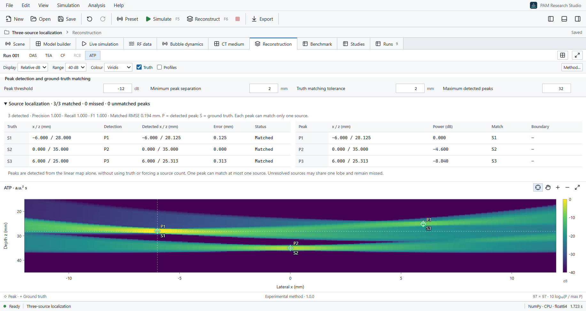
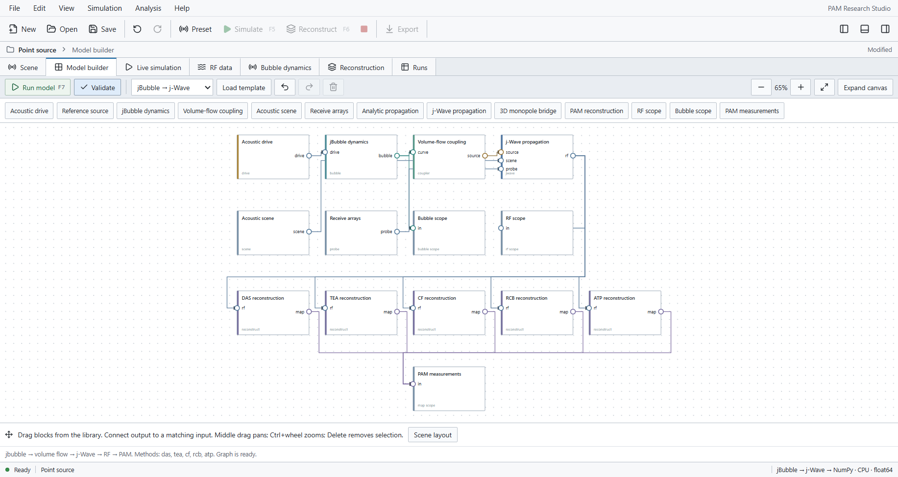

# PAM Research Studio 0.11

Windows desktop workbench for synthetic passive acoustic mapping. Electron/React interface, local Python engine, five numerical reconstruction methods: passive DAS, TEA, CF-DAS, RCB and ATP.

**Multiple-source localization** now detects independent local peaks and labels P1…Pn alongside ground truth S1…Sn. Adjustable relative-power threshold, physical peak separation and truth matching tolerance feed one-to-one matching, per-source errors, missed/extra counts, precision/recall/F1 and matched RMSE. CSV/JSON and PDF preserve criteria and assignments. See [detector definitions](docs/PEAK_DETECTION.md) and the [real three-source example](examples/multiple_sources/README.md).



Repository: [aisyalfawwaz/pam-research-studio](https://github.com/aisyalfawwaz/pam-research-studio). Clone with `git clone https://github.com/aisyalfawwaz/pam-research-studio.git`, then enter `pam-research-studio` and follow the setup below. The repository is private and requires an authorized GitHub account.

**Studies** now executes real parameter sweeps, noise-free convergence checks and seeded uncertainty trials with actual capture/calibration mismatch. Per-source bubble overrides run heterogeneous independent populations through the monopole or coupled j-Wave pipeline. Saved CT RF can be reconstructed using experimental straight-ray slowness delays. PDF reports and WebM videos use saved numerical results and include hash/provenance companions. See [definitions, workflow and limitations](docs/RESEARCH_STUDIES.md) and [frozen research examples](examples/research_refinements/evidence.json).

**Bubble dynamics** now animates the actual saved R(t), with fixed physical scale, wall-motion arrows, synchronized time cursors and Play/Pause/seek/sample-step controls. Lipid shell buckling/elastic/rupture regimes come from the run's saved smooth Marmottant parameters. Event buttons jump to extrema or the first nominal rupture crossing. Radial shell rupture is distinguished from unresolved bubble fragmentation. See [bubble motion, timing and model definitions](docs/BUBBLE_DYNAMICS.md).

Actual inspector screenshots: [expanded bubble](docs/images/bubble-motion-expanded.png) · [compressed bubble](docs/images/bubble-motion-compressed.png) · [compact workspace](docs/images/bubble-motion-compact.png).

Version 0.8 refines the connected workspace: method/DSP controls update the executable diagram, solver changes preserve compatible parameters, projects restore their own analysis settings, and loading a run restores its method parameters and original timing. Replay uses raw acquisition with the correct capture clock. Benchmark now shows exact changed settings and current-minus-reference score deltas, with direct PAM/RF inspection and project-specific selection. See [verification and limitations](BUILD_REPORT.md).

Native evidence: [refined benchmark workspace](docs/images/workspace-refinements.png), [paired PAM maps](docs/images/workspace-refinements-maps.png), and [reproducible report-1.1 example](examples/workspace_refinements/README.md). Current verification: all 73 Python, 26 TypeScript and 13 native Electron scenarios passed on Windows.

**Benchmark** evaluates saved PAM results with localization error, FWHM, truth-ROI concentration, background peak dB, contrast, CNR, gCNR, half-power area and entropy. Choose a run/reference, inspect physical truth disks and maps, adjust ROI radius/histogram bins, sort rows and export CSV/JSON. RF/settings fingerprints distinguish matched comparisons from changed experimental scenarios. Existing runs remain immutable; new experiment bundles include benchmark reports. Read [metric definitions and actual five-method scores](docs/PAM_BENCHMARK.md).

Developed as an **MRes Project by Aisy Fawwaz · Bioengineering · Imperial College London**. An original source/wavefront/receiver-array emblem identifies the app. The startup splash credits jbubble, j-Wave and the method researchers; **Help → About & credits** retains their full names, references and library licenses after startup.

The drag-and-drop **Model builder** runs **jbubble → volume flow → j-Wave → multi-array RF → PAM** end to end. Live simulation shows actual solver fields, radial bubble motion, sensor histories and computed reconstruction chunks; completed runs support replay. The built-in analytic CPU pipeline remains available offline.

**CT medium** now loads a bundled attributed head CT DICOM, a synthetic skull phantom, or a single imported CT slice. Edit the physical crop and HU-derived speed/density, position source/arrays in Scene, then run matched **water reference / CT medium** calculations. A whole-slice 0.1 MHz preset and fast skull patch are included. **Receive conditioning** integrates real SciPy DC removal, detrend, Butterworth filters and notch filtering, with raw/conditioned RF inspection, response curves and reproducible export. See [DSP, CT workflow, credits and numerical limitations](docs/DSP_AND_CT.md). Propagation is experimental **2D fluid acoustics with zero absorption and no shear**; PAM offers homogeneous delays or an experimental fixed straight-ray CT slowness model; neither models refracted/multipath receive propagation.



## Run

Initial setup requires Node 24+, pnpm 11.25 and uv. Python 3.13 and dependencies (including ReportLab for PDF reports) are provisioned locally. Network access is only needed for initial setup.

```powershell
cd "D:\Fawwaz\S2 Imperial\PAMBench OS Project"
uv sync --locked --python 3.13
pnpm install --frozen-lockfile
node scripts/ensure-electron.mjs
pnpm dev
```

Alternatively, run `scripts/setup.ps1` for setup/build. To use the built renderer without Vite:

```powershell
pnpm build
pnpm start
```

The app starts and stops its Python worker automatically. The worker binds to 127.0.0.1 on a dynamic port and uses an ephemeral token held by Electron's main process. Normal calculations require no MATLAB, WSL, GPU, online service, account or external dataset.

## Workflow

For the coupled demo: create a project → **Model builder** → choose **jBubble → j-Wave** → **Load template** → **Scene layout** to position arrays → return to Model builder → **Validate** → **Run model / F7**. Double-click blocks for their parameters. Expand the canvas/monitor for more space. Live simulation shows physical simulation time; CPU execution is not ultrasound wall-clock real time. Pause/play/seek replays recorded field samples. All selected PAM maps are calculated after RF acquisition.

**Model → Receive array** supports **1–8 arrays and up to 1024 total elements**. Set element count, pitch/aperture, centre x/z and angle; select and drag arrays directly in Scene. Actual element positions drive propagation and receive delays. Channel inspection/export accepts indices 0–1023. Aperture masks use 64-channel pages. Defaults remain 64 channels for quick CPU work.

Large captures have a **64 MiB raw RF budget**: 1024 channels support at most 8192 samples. j-Wave also limits receiver histories to 96 MiB and retains its domain/CFL/work limits; a large physical aperture can exceed its grid budget. Uniform single-array RCB supports 1024 active channels using exact subarray covariance accumulation, adaptive pixel batches and a 5-billion-term large-array work limit. Multiple/irregular-array RCB retains its **64 active-channel** full-covariance limit; choose a mask or DAS/TEA/CF/ATP for larger layouts. Channel count alone does not guarantee improved resolution. Read [capacity and branding](docs/CAPACITY_AND_BRANDING.md) and [coupling definitions](docs/WORKFLOW_AND_COUPLING.md).

The original analytic reference workflow remains available:

1. **File → New project**: enter a name and choose a project folder.
2. **Preset**: load a 64-channel point source. Edit the scene in the Properties panel or drag sources in the geometry view.
3. **Simulate / F5**: generate RF. Inspect the channel-time overview, individual waveform and Hann-windowed spectrum.
4. **Properties → Analysis**: select methods and parameters. The preset selects all five, with known synthetic emission timing for ATP.
5. **Reconstruct / F6**: calculate the selected methods from the same RF. Switch method tabs or tile plots. The lower Measurements panel reports physical peak locations, localization error, FWHM and background ratios.
6. **Export / Ctrl+E**: export a ZIP and companion folder. Raw RF inclusion is explicit. **File → Import experiment** checks hashes and schema before opening a package.

## Optional j-Wave and jbubble

Both optional runtimes are installed and tested on the development machine. For a fresh checkout:

```powershell
pwsh -File scripts/setup-jwave.ps1
pwsh -File scripts/setup-jbubble.ps1
```

Restart the app and choose **Model → Simulation backend → Solver**:

| Pipeline | Actual computation | Controls / output |
|---|---|---|
| Analytic | Homogeneous straight-ray reference | Finite source waveform → RF |
| j-Wave | j-Wave 0.2.1, Fourier k-space 2D linear acoustics | Spacing, CFL, PML, density → RF |
| jBubble | jbubble 0.2.0, Keller–Miksis + retarded 3D monopole bridge | Free/lipid bubble, radius, pressure, viscosity, ringdown, tolerance → trajectory + RF |
| jBubble → j-Wave | Radial dynamics → causal volume flow → equivalent 2D line source | Out-of-plane length and bandwidth → field movie + multi-array RF |

All four feed DAS/TEA/CF/RCB/ATP. The **Bubble dynamics** document shows real radius, drive, emission at 1 mm and wall-velocity curves. Library metadata, exact parameters, runtime versions/hashes and trajectories are preserved in runs and exported packages. Missing runtimes disable the respective option; simulations never silently fall back to another solver.

j-Wave uses Python 3.12/JAX 0.4.38; jbubble uses Python 3.13/JAX 0.8.2. Each has its own environment and lockfile. Neither changes the main engine environment. Native Windows CPU is locally tested and **experimental**; upstream j-Wave still recommends WSL2. No GPU or WSL execution is claimed. No network is needed after setup.

j-Wave models 2D line-source spreading. The coupled path injects filtered `Q=4πR²Rdot` using an explicit equivalent line length; no acoustic feedback, bubble interactions or 3D pressure equivalence is claimed. The source filter is causal; its recorded delay is applied once to ATP timing. The separate jbubble-only path retains its 3D monopole bridge. Nonlinear bubble harmonics require gate stride 1 and may alias receiver apertures. Read the [j-Wave adapter](adapters/jwave/README.md), [jbubble adapter](adapters/jbubble/README.md) and [coupling derivation](docs/WORKFLOW_AND_COUPLING.md).

Grid, emission-time gate and aperture may be changed and reconstructed without regenerating RF. Changing the source, medium or acquisition requires simulation again. Reanalysis creates a new run; existing arrays and run records are unchanged. Drafts autosave after validation.

## Workspace controls

| Control | Function |
|---|---|
| Project tree | Select the model, RF runs or reconstruction results |
| Scene / Model builder / Live simulation / RF / Bubble dynamics / Reconstruction / Runs | Change the active document |
| Model builder F7 | Validate and execute the connected scientific workflow |
| Array drag / arrow keys | Edit receiver positions; Shift uses 1 mm steps |
| Model / Analysis properties | Edit physical inputs and method parameters |
| Panel separators | Resize with drag or arrow keys; layout is remembered |
| View menu | Show/hide panels, toggle profiles/markers, tile results, change theme or reset layout |
| Plot toolbar / mouse wheel | Inspect, pan, zoom and fit axes |
| Map click / arrow keys | Move the axial/lateral profile cursor |
| Source drag / arrow keys | Edit source coordinates; Shift changes the keyboard step to 1 mm |
| Scene 1:1 button | Toggle equal physical scale; default view scales axes independently |
| Ctrl+Z / Ctrl+Y | Undo/redo model edits when focus is outside a text field |
| Ctrl+S / Esc / F1 | Save project / stop calculation / method reference |

The default interface uses a light desktop theme. **View → Dark theme** changes the application and plot backgrounds. Display scale, colour map, floor, zoom and layout changes do not alter scientific arrays or metrics.

## Methods

| Method | Calculation | Status |
|---|---|---|
| Passive DAS | Peak squared coherent receive sum | Reference implementation |
| TEA | Time-integrated coherent power; no self-energy subtraction | Reference variant |
| CF-DAS | Coherence factor applied to DAS amplitude before squaring | Experimental |
| RCB | Spherical steering-vector uncertainty optimization; Hermitian analytic covariance and spatial smoothing | Experimental |
| ATP | Short-pulse timing-gated coherent exposure; known-emission or calibrated axial plane-wave timing | Experimental |

RCB uncertainty radius and numerical covariance loading are separate controls. ATP requires a known timing reference and a short pulse. Exact definitions, assumptions, citations and validation evidence are in [scientific methods](docs/scientific-methods/reference.md). Synthetic tests are not independent publication validation. All amplitudes remain arbitrary units.

## Verification

```powershell
uv run pytest -q
uv run ruff check engine
pnpm test
pnpm test:e2e
```

Electron tests run the actual engine and replace only native file-dialog selections with temporary paths. They cover all five methods, export/reimport, source editing/undo, display invariance, panel controls, offline execution, invalid inputs and cancellation. The CI definition targets Windows/Linux; hosted CI execution is not claimed.

## Reproducible examples

```powershell
uv run python -m pamstudio.cli demo .local/my-study --methods das tea cf rcb atp --atp-known --export .local/my-study.zip
uv run python -m pamstudio.cli reproduce examples/five_methods_64ch/bundle
uv run python -m pamstudio.cli reproduce examples/jwave_64ch/bundle
uv run python -m pamstudio.cli reproduce examples/jbubble_64ch/bundle
uv run python -m pamstudio.cli reproduce examples/coupled_arrays/bundle
uv run python -m pamstudio.cli reproduce examples/array_1024ch/bundle
```

Use a new folder for each CLI demo. `examples/five_methods_64ch` contains real 64-channel/4096-sample RF, five 128² maps, options, diagnostics, metrics, figures, method notes, bibliography and SHA-256 manifest. The original two-method example is preserved under `examples/point_source_64ch`. Schema 1.0 packages from the earlier build remain readable.

## Files and limits

- `apps/desktop/src`: instrument shell, dock layout, property editor, plots and workbench state.
- `engine/src/pamstudio`: simulation, reconstruction, constrained RCB solver, jobs, SQLite/HDF5 storage and export.
- `packages/contracts`: request schemas, method registry snapshot and generated OpenAPI.
- [Build report](BUILD_REPORT.md), [implementation status](IMPLEMENTATION_STATUS.md), [UI design notes](docs/UI_DESIGN.md).

The app imports its own experiment packages and single CT DICOM anatomy slices. Generic lab RF, MATLAB/UFF/IQ, 3D DICOM stacks, arbitrary material painting and other simulator adapters are not implemented. Coupling is one-way, radial-to-2D: nonspherical breakup, jets, feedback and full 3D multiphysics are absent. A package without raw RF can display maps, trajectory and stored wave previews; load its configuration and simulate to inspect RF again.

The tested delivery is the native developer app. A bundled Python executable and signed installer are not delivered; see [packaging](docs/packaging.md). Original source licensing remains an owner/institutional decision. Dependency credits are retained in LICENSES_THIRD_PARTY.md. Research and education only; no clinical pressure, dose or safety inference.

